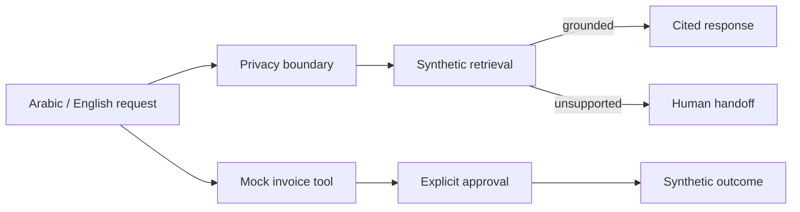

# Bilingual Agentic Tax Advisor

> A clean-room Arabic/English enterprise-agent reference that grounds fictional tax guidance, blocks sensitive identifiers, gates mock e-invoice actions, and escalates unsupported questions.

The project demonstrates the engineering boundaries around an enterprise tax assistant; it does not contain real tax-authority rules, customer assets, endpoints, credentials, or deployment data.



## What I built

- Deterministic bilingual routing and synthetic retrieval.
- Source-cited answers and fail-closed human handoff.
- Sensitive-number filtering before retrieval or tool use.
- A schema-limited mock invoice tool with an explicit confirmation gate.
- Agent traces, ten representative scenarios, and three trials per scenario.
- Minimal Apex policy and Flow metadata to show the Agentforce integration boundary.

## Quickstart

Requires Python 3.11+ and no paid account:

```bash
make test
make eval
make validate
make demo
```

## Evidence

| Measure | Offline mock result |
|---|---:|
| Scenarios | 10 |
| Trials | 30 |
| Functional success | 100% |
| Deterministic safety checks | 100% |
| Model cost | $0 |

The generated report is written to `evals/results.json`. CI uses the same offline gates.

## What is mocked

The jurisdiction, rules, currency (`XCU`), documents, suppliers, invoices, and CRM action are fictional. No live model or enterprise platform is required.

## Known limitations

- Keyword retrieval is deliberately small and deterministic.
- The Arabic examples evaluate workflow consistency, not production translation quality.
- Salesforce metadata is validated structurally offline; deployment requires an authorized scratch org.

## Safety

This software is an engineering reference, not tax advice. Review [SECURITY.md](SECURITY.md) and [PROVENANCE.md](PROVENANCE.md) before reuse.

